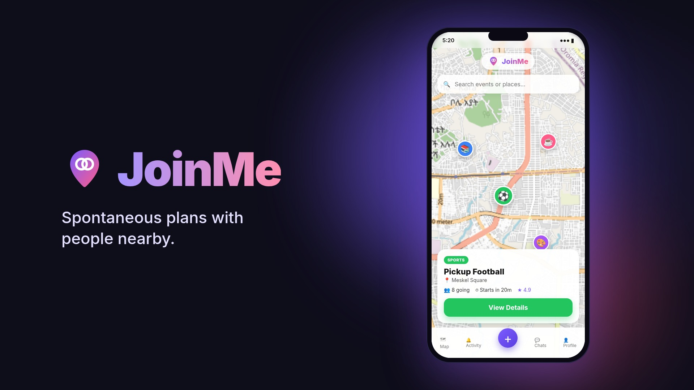

# JoinMe

**Free tonight? JoinMe shows what's happening near you and drops you into a small group to plan it.**

JoinMe is a location-based mobile app for spontaneous plans. See activities pinned on a map near you — study sessions, pickup football, coffee, sketch jams — join one, and you're placed in a small group chat to introduce yourselves and agree where to meet. After the event, everyone rates each other, so reputation is earned.

## 🎬 Demo

[](demo/joinme-demo.mp4)

*Click the image to watch the 20-second demo.*

## 🧭 How JoinMe works

### Joining something

1. **Open the map.** Events happening near you show up as pins: ⚽ sports, 📚 study, ☕ chill, 🎨 creative. Tap a pin to see what it is, where, when it starts, who's hosting and how reliable they are.
2. **Tap *Join Event*.** Instead of one huge chat for everyone, JoinMe puts you in a **small group**. The host decides how many people fit in a group (say 6). When a group is full, the next person opens a new one automatically, so a popular event becomes several small, easy-to-plan groups rather than one crowded chat.
3. **Meet your group.** You land straight in your group's chat. Introduce yourselves and agree on exactly where to meet ("north gate at 5:40?").
4. **Go and have a good time.**
5. **Rate afterwards.** Once the event has ended, everyone rates the event, the host and the people in their group from 1 to 5 stars. Those ratings add up to each person's **reputation**, shown on their profile and next to their name, so you can tell who is reliable before you join. Only the average is public; nobody sees who gave them which rating.

### Hosting something

Can't find what you're looking for? **Long-press anywhere on the map**, or search for a place, and create your own event: give it a title and category, pick the start time and how long it lasts, set how many people fit in each group, and optionally add a cover photo. You're the host and you start in Group 1. You can cancel the event any time before it starts.

### Staying in touch

Met someone you'd like to see again? Tap their photo in a group to see their reputation and **add them as a friend**. Friends can message each other directly, and the **Activity** tab tells you when someone sends a request, accepts yours, joins your event or messages you.

## 👥 Team

- Edna Mesfin
- Rufael Melese

## 🚀 Features

- 📍 **Map of nearby activities** — events appear as pins and update live; search for events or any place (e.g. "Bole") and fly the map there
- 🎉 **Create events** — long-press the map or search a place, set the time, duration (presets or custom), people per group and an optional cover photo
- 🤝 **Auto-splitting groups** — joining puts you in the first group with room; when every group is full, a new one opens automatically
- 💬 **Live group chat** for each group, readable only by its members
- ⭐ **Ratings & reputation** — after an event, rate the event, the host and your group mates; reputations are averages, individual ratings stay private
- 👥 **Friends** — find people by name, or tap someone you met at an event; send, accept or decline requests
- ✉️ **Direct messages** between friends, in real time
- 🔔 **Notifications** for friend requests, accepted requests, people joining your event and new messages
- 🖼️ **Profile photos and event cover images**
- 🔐 **Accounts** — email/password or Google sign-in, password reset by email
- 🗑️ **Cancel an event** you host, any time before it starts
- 🌙 **Dark and light themes**

## 📱 Screens

Onboarding · Login / Sign up · Reset password · Map · Create event · Event details · Group chat · Rate event · Chats · Direct chat · Friends · Notifications · Profile · Edit profile

## 🛠️ Tech Stack

- Flutter & Dart (Material 3)
- flutter_map with OpenStreetMap tiles and place search
- Supabase — Postgres, Auth (email + Google), Realtime, Storage, row level security

## ⚙️ Under the hood

Data rules — who can read a chat, who can message whom, who can rate whom and when ratings open — are enforced in the database with row level security, not just in the app. Joining an event runs in a Postgres function that locks the event, so two people can never take the same last spot in a group. Ratings are submitted in a single transaction, and notifications are created by database triggers.

## ▶️ Running the project

1. **Database (once):** open your Supabase project → SQL Editor, paste all of `supabase/schema.sql`, and run it. It is safe to re-run.
2. **Auth settings:** for testing, turn off Authentication → Providers → Email → "Confirm email". Under Authentication → URL Configuration → Redirect URLs, add `io.supabase.joinme://**` (used by Google sign-in and password reset).
3. **Config:** the project URL and publishable key live in `lib/config/supabase_config.dart`.

```
git clone https://github.com/Rufaelu/joinme.git
cd joinme
flutter pub get
flutter run
```

Tests:

```
flutter test                     # unit and widget tests
dart run tool/smoke_test.dart    # end-to-end check against Supabase (signs up 3 test users)
```

If the Android build fails with a bare Java version number (e.g. "27"), build with JDK 17:
`JAVA_HOME=/usr/lib/jvm/java-17-openjdk flutter build apk`
